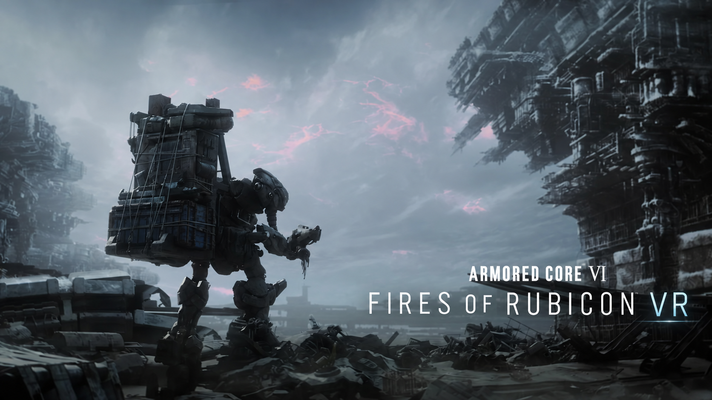

  

  
  
  

  

  <b>Armored Core VI, explored in virtual reality.</b> 
  An experimental community project investigating a path to PC VR for C4-621.

## Current progress

A proof of concept has displayed the game in a PS VR2 headset and followed the player's head orientation. The headset view and calibrated horizontal and vertical tracking were confirmed during a hands-on trial.

A GPU texture-sharing capture path has been tested with the live game, and paired color and depth have been captured on its D3D12 graphics queue. See the [render and capture research notes](RENDER_CAPTURE_FINDINGS.md) for the earlier experiments.

The observed perspective matrix allows depth reconstruction in game units. Separate eye views were first generated offline on CPU and D3D12; the resulting **static stereo scene was displayed in PS VR2**, where the user confirmed perceived depth without double vision. See the [projection and stereo findings](PROJECTION_FINDINGS.md).

A **continuous GPU color/depth stream** now presents stereo from the running game in PS VR2. In a bounded headset trial, the independent D3D12 consumer produced 1,349 stereo updates, and SteamVR recorded 1,408 visible frames. The user confirmed that moving the camera with a conventional controller updated the scene with depth and without double vision. See the [live stereo findings](LIVE_STEREO_FINDINGS.md).

Follow-up trials combined live stereo with head orientation and configurable output quality. The latest bounded trial used **2560×1440 per eye and a 90-degree rotation limit**; the user reported a clearer image with no noticeable stutter. This is the current explicit reference profile, while the program defaults remain 720p/25°. See the [quality and pacing findings](QUALITY_PACING_FINDINGS.md).

This remains an early experiment: sustained comfort, frame pacing, metric scale, and per-eye OpenXR projections need further work. Sense controller input is not implemented; the game uses its normal PC controls. It is not a complete VR conversion or a public release.

## Source, build and verification

This repository contains the experimental diagnostic source, **not an installer or a public game-ready release**. Developers can use [BUILDING.md](BUILDING.md) for pinned dependencies, supported build commands, safe test gates and the separation between CI and headset validation.

For the latest verified state, start with [QUALITY_PACING_FINDINGS.md](QUALITY_PACING_FINDINGS.md) and [LIVE_STEREO_FINDINGS.md](LIVE_STEREO_FINDINGS.md). Several older research notes intentionally preserve the earlier state of the prototype; their historical pending gates are not the current project status.

The project has not yet selected a software license. Armored Core VI and third-party tools remain subject to their respective terms.

## Project

The work is exploring whether Armored Core VI can become a comfortable, stereoscopic PC VR experience. Next steps are longer validation, measured pacing improvements, and correct eye projections and scale.

Follow along as the project develops, and [support the work on Ko-fi](https://ko-fi.com/onitaku) if you would like to help.

---

An unofficial fan project, not affiliated with or endorsed by Bandai Namco Entertainment or FromSoftware. Armored Core VI is required and is not included.
